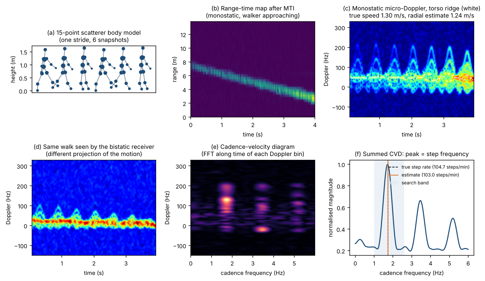
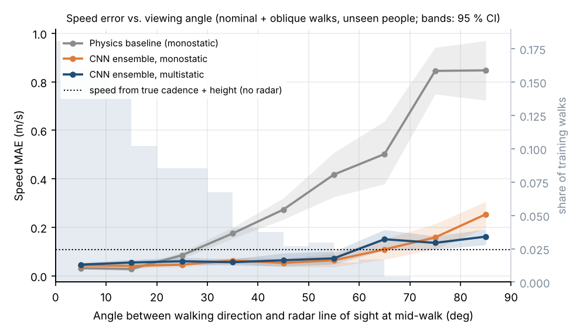
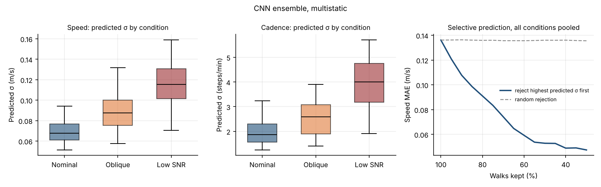
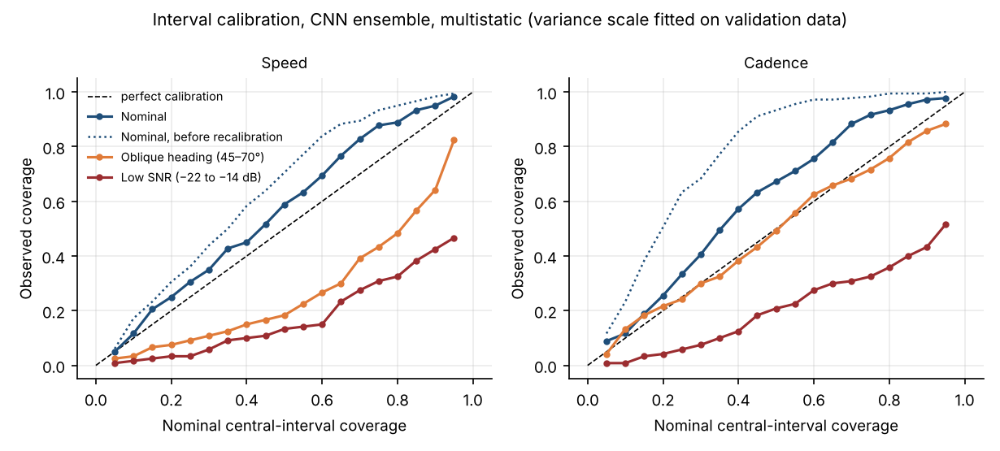
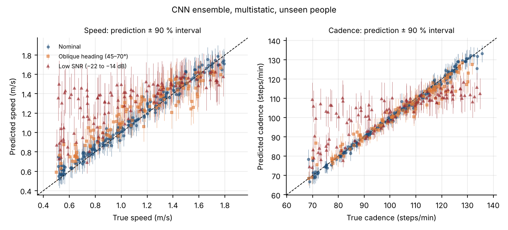
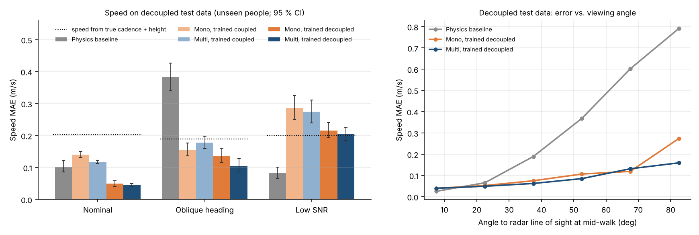

# Radar Gait Sensing with Uncertainty

**Estimating walking speed and cadence from FMCW radar micro-Doppler, and testing whether the model knows when not to trust its estimate.**

Most radar human-sensing work stops at classifying activities ("walking", "sitting"). Clinically useful gait analysis needs *quantities*, such as gait speed and step rate, together with an honest statement of how reliable each number is. This project builds and evaluates the full chain for that question:

1. A **physics-based simulator** of a walking person seen by a 5.8 GHz FMCW radar, in **monostatic and bistatic** configurations.
2. A **classical signal-processing baseline**: torso-Doppler speed and cadence-velocity-diagram (CVD) step rate.
3. A **deep ensemble of heteroscedastic CNNs** that predicts speed and cadence as Gaussian distributions, separating aleatoric and epistemic uncertainty.
4. A **subject-disjoint evaluation** with two deliberately **out-of-distribution test conditions** (oblique walking headings, low SNR), 95 % confidence intervals from a subject-level cluster bootstrap, and paired method comparisons.
5. A **decoupling experiment** that retrains everything on gait in which speed and cadence vary independently, to test directly whether the networks rely on the speed–cadence coupling.
6. A **real-data path** for Infineon BGT60 (60 GHz) recordings, tested on simulated recordings in the same format; measured results will be added when the recordings are processed.



## Results at a glance

Mean absolute error on 6 unseen people (120–180 walks per condition). Brackets give the 95 % CI from a subject-level cluster bootstrap.

| Speed MAE (m/s) | Physics baseline | CNN, monostatic | CNN, multistatic |
|---|---|---|---|
| Nominal | 0.114 [0.101, 0.131] | **0.046** [0.038, 0.055] | **0.045** [0.037, 0.056] |
| Oblique heading, 45–70° (unseen range) | 0.448 [0.369, 0.537] | **0.122** [0.099, 0.149] | **0.120** [0.105, 0.133] |
| Low SNR, −22 to −14 dB (unseen range) | **0.085** [0.065, 0.105] | 0.284 [0.224, 0.342] | 0.289 [0.232, 0.345] |

| Cadence MAE (steps/min) | Physics baseline | CNN, monostatic | CNN, multistatic |
|---|---|---|---|
| Nominal | **0.98** [0.87, 1.10] | 1.13 [0.99, 1.26] | 1.17 [0.99, 1.34] |
| Oblique heading | 11.85 [7.07, 17.20] | 4.30 [3.02, 5.69] | **2.63** [2.28, 3.05] |
| Low SNR | 11.26 [9.37, 13.01] | 9.76 [7.83, 11.95] | 9.72 [7.76, 11.81] |

All metrics, including calibration, paired differences and the diagnostics below, are in [`results/metrics.md`](results/metrics.md) and [`results/metrics.json`](results/metrics.json).

## Findings: main experiment (typical, speed-coupled gait)

1. **For speed, learning clearly beats the radial-Doppler baseline, except at low SNR.**
   - Nominal: the monostatic CNN's error is **2.5× lower** than the baseline's (0.046 vs. 0.114 m/s).
   - Oblique headings: it is **3.7× lower** (0.122 vs. 0.448 m/s).
   - Why the baseline fails at angles: a monostatic radar measures only the radial component of motion, so its error grows from 0.03 m/s at viewing angles below 20° to 0.85 m/s above 70° (Fig. 2).
   - The CNNs' advantage comes from the larger angles. Below 20° the baseline is slightly *more* accurate (0.03 vs. 0.04–0.05 m/s); the CNNs stay at 0.04–0.07 m/s up to 60°.
   - Low SNR reverses the ranking: the baseline is significantly better (paired difference −0.20 m/s, CI [−0.26, −0.13]). It needs only the strong torso line, which survives noise; the CNN relies on weaker limb micro-Doppler.

2. **For cadence, the classical cadence-velocity diagram is hard to beat on clean signals.**
   - Nominal: baseline and CNNs are statistically indistinguishable (0.98 vs. 1.13 steps/min; paired CI [−0.36, +0.02]).
   - Oblique headings: the CNNs are far better than the baseline.
   - Low SNR: every method degrades to about 10–11 steps/min.

3. **On typical gait, a second (bistatic) receiver helps cadence at oblique headings, but not speed.**
   - Cadence at oblique headings improves from 4.30 to 2.63 steps/min (paired difference +1.66, CI [+0.73, +2.68]).
   - For speed, monostatic and multistatic CNNs are statistically indistinguishable in every condition (all paired CIs include zero).
   - I expected the extra geometry to resolve the radial-velocity ambiguity for speed. The decoupling experiment shows why it did not: the networks had a cheaper shortcut (finding 8).

4. **On typical gait, reliance on the speed–cadence prior is hard to see in the errors.**
   - In the data, walking speed and cadence are strongly coupled (r = 0.91). A linear model using only the *true* cadence and height, with no radar at all, predicts speed to 0.10–0.11 m/s.
   - If a network leans on this coupling, its speed errors should correlate with that predictor's errors. On typical-gait test data the correlation is weak in nominal conditions (r = 0.06–0.16), slightly higher at oblique headings (0.16–0.23) and clear only at low SNR (0.39–0.40); at low SNR the predictions also shrink toward the average speed (Fig. 3).
   - This diagnostic *understates* the reliance: on typical gait the prior is usually right, so it barely shows in the errors. The decoupling experiment measures it directly and finds it in every condition (finding 7).

5. **Uncertainty detects noise and viewing-angle shifts but is not calibrated under them.** Results for the multistatic ensemble, with variance recalibrated on validation people:
   - Mean predicted σ for speed rises from 0.069 (nominal) to 0.089 (oblique) and 0.116 m/s (low SNR).
   - Pooled over all conditions, |error| and σ are rank-correlated (Spearman 0.64).
   - Deferring the 20 % least confident walks lowers pooled speed MAE by a third, from 0.136 to 0.091 m/s. Deferring 40 % lowers it to 0.059 m/s (Fig. 5).
   - Coverage tells a different story: the 90 % intervals cover 95.0 % of nominal walks, but only 64.2 % of oblique and 42.5 % of low-SNR walks for speed (cadence: 97.2 %, 85.8 %, 43.3 %; Fig. 4). Calibration fitted on familiar data does not transfer to unfamiliar conditions.

6. **Uncertainty says *that* something is wrong, not *why*.** A simple rule switches from the monostatic CNN to the physics baseline whenever the CNN's speed σ exceeds its 95th validation percentile.
   - At low SNR it helps (0.284 → 0.107 m/s), because the baseline is reliable there.
   - At oblique headings it hurts (0.122 → 0.335 m/s), because the baseline is the method that breaks.
   - A useful fallback has to know the *source* of the uncertainty, not only its size.





<p align="center">
  
  
</p>

## Decoupling experiment: do the networks rely on the speed–cadence coupling?

The same 40 people, splits and conditions were simulated again, with one change: speed and cadence are drawn **independently**, accepted only if the resulting step length is plausible (0.22–0.50 × body height, cadence 62–150 steps/min). This lowers the speed–cadence correlation from 0.91 to 0.57, the minimum the mechanics of walking allow here (speed = step length × step rate). A prior-only predictor (true cadence + height, no radar) degrades from 0.10–0.11 to 0.19–0.20 m/s on this data. Both CNN families, trained on coupled (**C**) or decoupled (**D**) data, are tested on both kinds of data. Each family is recalibrated on its own validation people.

| Speed MAE (m/s), decoupled test data | Physics baseline | Mono C | Multi C | Mono D | Multi D |
|---|---|---|---|---|---|
| Nominal | 0.102 [0.086, 0.123] | 0.140 [0.131, 0.150] | 0.118 [0.113, 0.123] | 0.050 [0.041, 0.058] | **0.045** [0.039, 0.050] |
| Oblique heading | 0.382 [0.340, 0.427] | 0.154 [0.137, 0.176] | 0.177 [0.159, 0.198] | 0.135 [0.116, 0.160] | **0.105** [0.086, 0.127] |
| Low SNR | **0.082** [0.066, 0.101] | 0.286 [0.251, 0.325] | 0.275 [0.240, 0.311] | 0.216 [0.194, 0.241] | 0.205 [0.185, 0.225] |

| Speed MAE (m/s), typical-gait test data | Physics baseline | Mono C | Multi C | Mono D | Multi D |
|---|---|---|---|---|---|
| Nominal | 0.114 [0.101, 0.131] | 0.046 [0.038, 0.055] | 0.045 [0.037, 0.056] | 0.049 [0.045, 0.052] | **0.041** [0.036, 0.046] |
| Oblique heading | 0.448 [0.369, 0.537] | 0.122 [0.099, 0.149] | **0.120** [0.105, 0.133] | 0.166 [0.141, 0.192] | 0.122 [0.107, 0.135] |
| Low SNR | **0.085** [0.065, 0.105] | 0.284 [0.224, 0.342] | 0.289 [0.232, 0.345] | 0.256 [0.210, 0.307] | 0.233 [0.188, 0.280] |

Full tables, including cadence, paired differences, error correlations and coverage: [`results/decoupled/metrics_decoupled.md`](results/decoupled/metrics_decoupled.md).

7. **Networks trained on typical gait rely on the speed–cadence shortcut in every condition.**
   - When the coupling is removed at test time, their nominal speed error roughly triples: monostatic 0.140 vs. 0.050 m/s for the decoupled-trained model (paired difference +0.090, CI [+0.080, +0.106]); multistatic 0.118 vs. 0.045 m/s (+0.073, CI [+0.064, +0.082]). They become worse than the physics baseline (0.102 m/s).
   - Their speed errors now track the prior-only predictor's errors closely (r = 0.63–0.85 across conditions).
   - Their uncertainty is essentially blind to this shift. On nominal walks their speed error rises by 207 % (mono) and 160 % (multi), but their predicted σ rises by only 6 % and 7 %. Their 90 % intervals cover only 53.9 % (mono) and 62.2 % (multi) of nominal decoupled walks, against 93.3 % for the decoupled-trained models.
   - The same holds for cadence: on decoupled nominal data, coupled-trained models reach 2.31 and 2.76 steps/min, against 1.43 and 1.46 for decoupled-trained models.

8. **Training on decoupled data removes the shortcut without hurting typical gait, and then the second receiver pays off.**
   - On typical gait, decoupled-trained models are as accurate as coupled-trained ones in nominal conditions (mono 0.049 vs. 0.046 m/s, paired CI [−0.010, +0.004]; multi 0.041 vs. 0.045 m/s, paired CI [−0.004, +0.013]).
   - Without the shortcut, multistatic geometry helps exactly where a monostatic radar is blind: at oblique headings, speed error drops from 0.135 to 0.105 m/s on decoupled data (paired +0.030, CI [+0.016, +0.039]) and from 0.166 to 0.122 m/s on typical gait (+0.044, CI [+0.022, +0.062]). In nominal conditions the gain is small (≤ 0.007 m/s).
   - The decoupled-trained multistatic ensemble has the lowest learned-model speed error in five of the six test conditions and is within 0.002 m/s of the best in the sixth.
   - One honest exception: on typical gait at oblique headings, the decoupled-trained *monostatic* model is worse than the coupled-trained one (0.166 vs. 0.122 m/s; paired −0.044, CI [−0.052, −0.034]). When the prior is valid, exploiting it compensates for monostatic geometry; the second receiver provides the same accuracy without relying on it.
   - Decoupled training also improves low-SNR speed (multistatic on typical gait: 0.289 → 0.233 m/s, paired +0.055, CI [+0.038, +0.073]), but the physics baseline remains far better there (0.085 m/s).

9. **What decoupling does not fix.**
   - Calibration under shift: on decoupled data the decoupled-trained models' 90 % speed intervals cover 93.3 % of nominal walks but only 64.2–68.3 % of oblique and 45.0–48.3 % of low-SNR walks.
   - Some prior use remains at low SNR (error correlation r = 0.75–0.81 on decoupled data), because the mechanics of walking keep speed and cadence partly coupled (r = 0.57).
   - The physics baseline remains the best cadence estimator on clean signals (decoupled nominal: 1.02 vs. 1.46 steps/min for the decoupled multistatic model; paired CI [−0.72, −0.16]).



## Method

### Simulation (`gaitradar/kinematics.py`, `gaitradar/radar.py`, `gaitradar/dataset.py`)

- **Body model.** 15 point scatterers (head, chest, pelvis, thighs, shanks, feet, upper arms, forearms, hands). Segment lengths follow Winter's anthropometric ratios, and amplitude weights roughly follow each segment's RCS.
- **Gait.**
  - Stride duration follows the Boulic relation T = 1.346 / √(v / H_leg), scaled by a per-subject cadence factor.
  - Hip amplitude is set so the stance-foot excursion matches the step length, and pelvis height follows the stance leg (double vertical bounce).
  - Stride-to-stride variability of ±3 % is applied to cadence and to speed. Labels are the means over each 4 s walk.
  - The swinging foot reaches about 4.4× walking speed, which is consistent with the foot covering a stride in roughly 40 % of the gait cycle.
- **Radar.**
  - 5.8 GHz FMCW, 400 MHz bandwidth (0.37 m range bins), 1 ms chirp (1 kHz PRF), 64 fast-time samples, 4 s observations.
  - The beat signal uses the propagation path |p − Tx| + |p − Rx| under the stop-and-hop approximation, so monostatic and bistatic radars share one code path.
  - Amplitudes follow the radar equation. Static clutter with slight vibration and complex white noise are added.
- **Processing.**
  - Range FFT → MTI (slow-time mean removal) → range gate 0.8–16 m → STFT per range bin (128 ms Hann window, 32 ms hop, 256-point FFT) → **incoherent** sum over range bins → spectrogram normalised to the top 45 dB, with 192 Doppler bins × 122 frames.
  - The Doppler window spans ±375 Hz, enough for the fastest foot (≈ 320 Hz at 1.85 m/s); a unit test checks this.
  - Why incoherent: summing *complex* range bins over a wide gate would cancel the target, because the sum of all bins of a windowed FFT equals the first windowed sample, which is zero for a Hann window.
- **Geometry and splits.** 40 synthetic subjects with heights 1.50–1.95 m. Speeds are 0.5–1.8 m/s. Walks are straight lines approaching or leaving the radar, with the bistatic receiver at (6, 7.5) m. Every walker stays at least 1.5 m from the radar and 2 m from the bistatic receiver.

| Split | Subjects | Walks | Conditions |
|---|---|---|---|
| train | 28 | 1,008 | heading ≤ 40°, SNR −6 to 8 dB |
| val | 6 | 144 | same; used for early stopping and recalibration |
| test | 6 (unseen) | 180 | same |
| oblique | test subjects | 120 | heading 45–70° |
| low_snr | test subjects | 120 | SNR −22 to −14 dB |

**Heading vs. viewing angle.** *Heading* is the angle between the walking direction and the radar's boresight axis. Because walkers start off axis and pass at different distances, the angle to the actual line of sight differs from the heading: 13 % of training walks exceed 40° at mid-walk. Fig. 2 therefore shows the line-of-sight distribution of the training data.

### Estimators

- **Physics baseline** (`gaitradar/baseline.py`):
  - **Speed:** the median over time of the frame-wise torso Doppler, taken as the spectral peak outside an 8 Hz clutter notch and refined with a power-weighted centroid over ±2 bins, then converted with v = f·λ/2.
  - **Cadence:** the peak of the summed CVD in the 1.0–2.6 Hz band, refined with parabolic interpolation. The band covers every walk in the evaluation splits.
- **CNN ensemble** (`gaitradar/model.py`, `scripts/train.py`):
  - **Architecture:** four conv blocks with global average and max pooling. The output is a mean and log-variance per target.
  - **Training:** β-NLL loss (β = 0.5) with AdamW and a one-cycle schedule for 24 epochs. Augmentation uses random time crops and an exact Doppler mirror around 0 Hz; both leave the labels unchanged.
  - **Ensemble:** 5 members trained from different seeds; each member keeps the epoch with the best validation NLL.
  - **Uncertainty:** total variance is the mean of the members' variances (aleatoric) plus the variance of their means (epistemic).
  - **Recalibration:** one post-hoc variance scale per target, fitted on validation data only.
  - **Inputs:** the monostatic model sees 1 channel; the multistatic model sees 2.

### Real-data path: Infineon BGT60 (`gaitradar/bgt60.py`, `scripts/analyze_bgt60.py`)

- Reads recordings as `(frames, rx, chirps, samples)` arrays with the recording's JSON configuration (key names of Infineon's Radar Fusion GUI / Radar SDK; every parameter can also be set on the command line).
- The BGT60 records in frames: a burst of chirps followed by an idle gap. Each frame therefore gives one Doppler spectrum (FFT across its chirps, power summed over range bins and RX channels), and consecutive frames form the spectrogram, which runs through the same physics baseline.
- Set-up checks for 60 GHz, printed as warnings:
  - Doppler aliasing: the unambiguous speed is λ / (4 t_chirp); feet at 1.8 m/s need chirp times ≤ ~160 µs.
  - Maximum range from the ADC Nyquist limit, for example ~1.7 m for a 5.5 GHz sweep in 64 µs at 2 MHz sampling, so walking recordings need less bandwidth.
  - Frame rate for cadence.
- Scores radial speed and cadence against a reference table (distance, duration, step count, heading).
- Tested end to end on simulated BGT60-format recordings (`simulate_bgt60_recording`); no measured results are reported yet.
- The CNNs are not applied to 60 GHz data, because they were trained on 5.8 GHz spectrograms. That needs the simulator re-run with the BGT60 configuration (a sim-to-real step).

### Statistics

95 % confidence intervals use a cluster bootstrap over subjects (2,000 resamples). People are resampled with replacement and all of their walks are kept together, because walks of the same person are correlated. Method comparisons are paired, computed on the same resampled walks. With six test people the intervals are wide, and they are reported as they are.

## Limitations

- **The data are simulated.** The point-scatterer model ignores body shadowing, aspect-dependent RCS, multipath, micro-motion of clothing and hardware impairments, and the stance foot is not pinned to the ground. Absolute errors on real measurements will be larger. The comparisons and failure modes are the transferable part.
- **Both gait regimes are simulated extremes.** The main experiment couples speed and cadence through the Boulic relation; the decoupling experiment removes the coupling as far as walking mechanics allow. Real gait, and especially pathological gait, lies somewhere in between.
- **Only straight walks** at constant mean speed were simulated, with one person and one room geometry.
- **Six test people:** the confidence intervals are wide.

## Next steps

- **Validate on real 5G/FMCW measurements** with IMU or optical motion-capture references.
- **Process the BGT60 recordings** with the real-data path (`scripts/analyze_bgt60.py`) and compare against a distance/stopwatch or IMU reference.
- **Treadmill or IMU-referenced data with deliberately varied cadence at fixed speed**, to confirm on real people that decoupled training and multistatic geometry remove the shortcut.
- **Physics-informed hybrid:** give the network the torso-Doppler and CVD features explicitly, and let it predict the *source* of its uncertainty (geometry vs. SNR) so the fallback can be chosen accordingly.
- **Distribution-free uncertainty:** conformal prediction, or calibration that accounts for shift, to keep coverage guarantees outside the training distribution.
- **More gait parameters:** step-time variability, left/right asymmetry, turning and balance.

## Reproduce

Requires Python ≥ 3.10.

```bash
pip install -r requirements.txt
./run_all.sh          # both experiments: 2 datasets, 4 ensembles, cross-tests, evaluation (~4 h on 2 CPU cores)
python scripts/audit.py   # independent recomputation of every reported metric
python -m pytest -q       # 10 unit tests
```

The unit tests cover:
- realistic cadence;
- limbs averaging to body speed;
- point-target range and Doppler;
- the Doppler window covering the fastest limb;
- the exact Doppler mirror used in augmentation;
- subject-disjoint splits;
- the baseline on a clean walk;
- the uncertainty metrics on a perfectly calibrated Gaussian;
- decoupled sampling;
- the BGT60 pipeline on a simulated recording.

The datasets are deterministic: regenerating the main dataset reproduces it bit for bit.

```
gaitradar/   kinematics.py  radar.py  dataset.py  baseline.py  model.py  uq.py  bgt60.py
scripts/     generate_dataset.py  train.py  evaluate.py  plot_signatures.py
             cross_predict.py  evaluate_decoupled.py  audit.py  analyze_bgt60.py
tests/       test_physics.py
results/     metrics.json  metrics.md  decoupled/metrics_decoupled.{json,md}  audit.log
figures/     fig1–fig6
```

## References

- R. Boulic, N. Magnenat-Thalmann, D. Thalmann, "A global human walking model with real-time kinematic personification," *The Visual Computer*, vol. 6, 1990.
- V. C. Chen, *The Micro-Doppler Effect in Radar*, Artech House, 2011.
- D. A. Winter, *Biomechanics and Motor Control of Human Movement*, 4th ed., Wiley, 2009.
- B. Lakshminarayanan, A. Pritzel, C. Blundell, "Simple and scalable predictive uncertainty estimation using deep ensembles," *NeurIPS*, 2017.
- M. Seitzer, A. Tavakoli, D. Antic, G. Martius, "On the pitfalls of heteroscedastic uncertainty estimation with probabilistic neural networks," *ICLR*, 2022.

## Author

Amirreza Piri, RF and measurement engineer (TU Graz, University of Pavia). MIT License.
